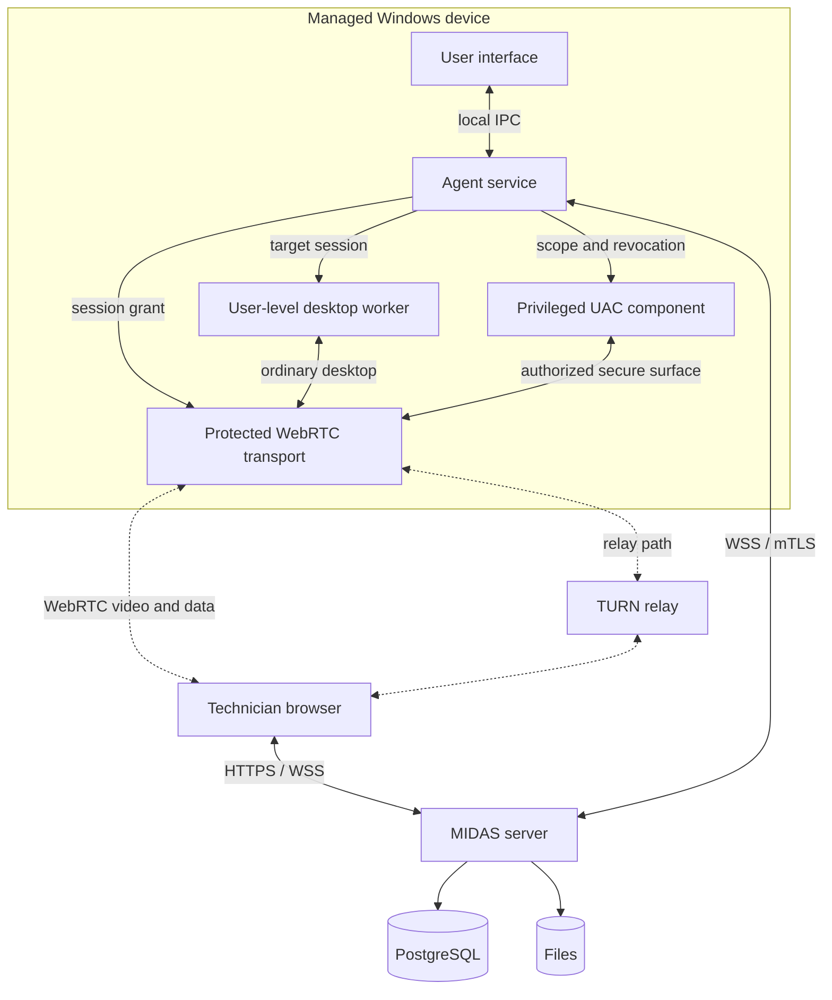
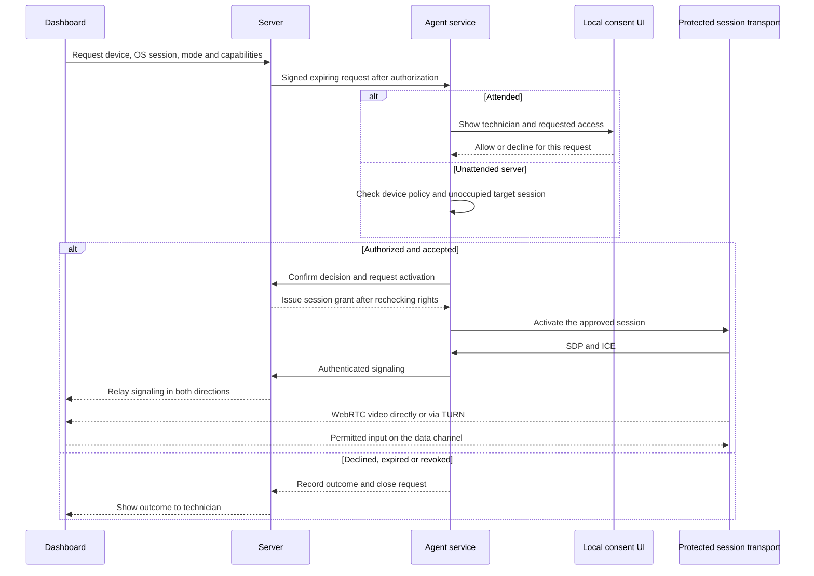
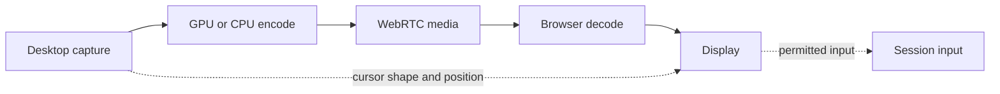

# MIDAS rendszerterv / System plan

[English](#english)

## Magyar

Készült 2026. szeptember 27-én, frissítve 2026. november 2-án. Tulajdonos [@Shran21](https://github.com/Shran21).

A MIDAS saját üzemeltetésű, több ügyfelet kiszolgáló távfelügyeleti rendszer terve. Néhány száz Windows- és Linux-eszköz egyetlen központból történő monitorozását, karbantartását és távsegítését célozza. Az agent és az adminfelület mindennapi használatát, az engedélyeket és a mérési feltételeket a [működési követelmények](kovetelmenyek.md) rögzítik.

A célműködést és a tervezett fájlszerkezetet írjuk le. A [felülvizsgált feladatlista](feladatlista.md) 96 ütemezett tételt és 6 külön javaslatot tartalmaz, minden tételnél státusszal, mérföldkővel, függőségekkel és elfogadási feltételekkel. Az induló felosztás közzétéve a [GitHub Projectben](https://github.com/users/Shran21/projects/4); az aktuális státusz ott követhető.

## Mi marad és mi változik

A kiinduló C#/.NET tervhez képest a biztonságos ügyfélelválasztás, a gyors távvezérlés és az egyszerű üzemeltetés indokolja az alábbi döntéseket.

| Terület | Régi terv | Új terv | Miért |
| --- | --- | --- | --- |
| Nyelv (agent és szerver) | C# / .NET 8 | Rust | Közös protokoll, natív Windows API-k és a háttérfolyamatok erőforrásigényének kézben tartása. |
| Képernyőátvitel | Képkockák SignalR WebSocketen | WebRTC-videó | A felek közös kodeket egyeztetnek, és lehetőség szerint hardveresen kódolnak és dekódolnak. |
| Egérmutató | A képbe égetve | Külön adatcsatorna és helyi rajzolás | A kurzor frissítése függetleníthető a videoképkockák érkezésétől. |
| Vezérlőcsatorna | SignalR | WebSocket (WSS) protobuf üzenetekkel, mTLS | Kicsi, típusos üzenetek, az agent és a szerver ugyanazt a definíciót használja. |
| Adatbázis | SQLite | PostgreSQL 18, particionált metrikatáblák, sorszintű jogosultság | Több ügyfél, párhuzamos írás, idősoros adatok. |
| Szervezeti modell | Egyetlen környezet | Ügyfél, telephely, eszközcsoport, eszköz | Az ügyfelek környezeteit egymástól elválasztva kell kezelni. |
| Agent felülete | WinForms | Tauri 2 | A közös UI-elemek és a Windows WebView2 futtatókörnyezete segíti a terjesztést. A csomagméret és a futás közbeni memória külön mérés. |
| Agent felépítése | Egy alkalmazás | Szolgáltatás, helyi felület, munkamenet-segéd és külön UAC-komponens | A felület a felhasználó munkamenetében kér jóváhagyást. Mindkét vezérlési mód UAC-képességét korai prototípus igazolja. |
| Böngészős belépés | Böngészőben tárolt hozzáférési token | Szerveroldali munkamenet, HttpOnly süti, passkey | A technikusi munkamenet visszavonható. |
| Helyi jelszó tárolása | Saját PBKDF2-megoldás | Argon2id véletlen sóval | A paraméterezést a biztonsági modell rögzíti. |
| Adattitkosítás | Saját AES-256-GCM | TLS 1.3 (rustls) és DTLS-SRTP; tárolt titkok bevált AEAD-könyvtárral, kulcsrotációval | Nincs saját kriptó, a TLS a szerverbe épül, külön proxy nélkül. |
| Agent-azonosítás | Egyedi eszközazonosság nélkül | Egyszeri regisztráció, jóváhagyás vagy ellenőrzött telepítési identitás, majd mTLS | A CA csak az ellenőrzött agent saját nyilvános kulcsához ad tanúsítványt. |
| Szerepkörök | 3 fix szerep | Szerepek és felhasználónként állítható engedélyek, ügyfélre szűkítve | Egy technikus csak a saját ügyfeleit látja. |
| Naplózás | Serilog, CSV-export | OpenTelemetry és külön, külső ellenőrzőponthoz kötött auditlánc | A független másolat segítségével az adatbázis utólagos módosítása is vizsgálható. |
| Címtár | Active Directory a régi ütemtervben | Helyi AD az alapoknál, Entra ID és AD FS az 5. fázisban | A címtárcsoportok ügyfélhez és MIDAS-szerephez rendelhetők. |
| Mobil | Natív app (roadmap) | Reszponzív mobilnézet a böngészőben, PWA-ként telepíthető, Web Push értesítéssel | Egy kódbázis, nincs áruházi kiadás. |
| Fejlesztőeszköz | Visual Studio IDE | Tetszőleges szerkesztő és parancssori build | A natív windowsos Tauri-buildhez Microsoft C++ Build Tools, Windows SDK és WebView2 szükséges. |
| Telepítés | `dotnet run`, Docker a roadmapon | Linuxon és Windowson is: aláírt telepítő és webes beállító varázsló | Kubernetes nélkül, mindkét rendszerre saját telepítővel. |
| Első belépés | Beégetett alapjelszó | Egyszer használható beállító link | A telepítő ellenőrzött úton adja át az első adminisztrátor hozzáférését. |
| macOS agent, Kubernetes | Roadmapon | Kimarad | A tulajdonos döntése. |

## Technológiai döntések

A három legnagyobb hatású döntés, amelyet a régi tervhez képest nyelvtől függetlenül újra meghoztunk.

### Nyelv: agent és szerver

A Rust közös protokollkönyvtárat ad az agentnek és a szervernek, és közvetlen hozzáférést tesz lehetővé a Windows képrögzítési és beviteli API-jaihoz. A biztonságos Rust korlátozza a memóriakezelési hibákat. Az FFI-t és az `unsafe` hívásokat kis, külön átnézhető modulokba zárjuk. A tényleges memóriahasználat és késleltetés a teljes feldolgozási úttól függ.

A vizsgált alternatívák közé a Go és a C# is tartozott. Ha a szerver Rustban tartós fejlesztési akadályba ütközik, külön döntési jegyzetben vizsgálható meg a Go-szerver és Rust-agent változat. A [RustDesk](https://github.com/rustdesk/rustdesk) példa Rust-alapú távsegítésre. Kód átvétele előtt fájlonként ellenőrizni kell a licencet, a szerzői megjelöléseket és a függőségeket.

### Asztali felület az agenthez

A Tauri 2 megoszthatja a React-komponenseket a dashboarddal. Windowson a WebView2-höz külön ellenőrizzük a futtatókörnyezet meglétét, a célgépeken a csomagméretet és a megnyitott felület memóriaigényét. Az Electron saját böngészőterjesztést igényelne, a WPF és a WinUI pedig külön Windows-felületet. A tálcaikon jelzi a kapcsolat állapotát. Az adminpanelről érkező kérés a megfelelő felhasználói munkamenetben nyitja meg a jóváhagyó ablakot. A nehezebb nézetek igény szerint töltődnek be. [Tauri előfeltételek](https://v2.tauri.app/start/prerequisites/)

### Képátvitel a távsegítéshez

A WebRTC natív böngészős lejátszást, médiatovábbítást, adatcsatornát és ICE-alapú útvonalválasztást ad. Közvetlen út hiányában az eturnal TURN-relé továbbítja a titkosított csomagokat. A WebTransport/WebCodecs irányhoz külön médialejátszási és hibakezelési logika kellene. A képkockák WebSocketen küldése csomagvesztéskor a TCP sorrendtartására várna. A könyvtárválasztás és a késleltetés ellenőrzése a 0. fázisú prototípussal kezdődik.

## Architektúra

A központi Rust-alkalmazás egy moduláris monolit. Kiszolgálja a dashboardot, az API-t és az agentek vezérlőcsatornáját. A központi adatbázis PostgreSQL 18, a fájltároló a csomagokat és az engedélyezett felvételeket kezeli. A TURN-relé külön szolgáltatás. Az alábbi ábra a Windowsos képernyővezérlés kapcsolatait mutatja. Linuxon a szolgáltatás systemd alatt fut, és helyi Unix-domain socket használható.



A folytonos vonal a vezérlést és az adatelérést, a szaggatott a WebRTC-útvonalakat jelöli. Az agent hitelesített csatornája viszi a jelzéscserét és a jogosultság megújítását. A videó, bevitel, kurzor és az engedélyezett munkamenet-adatátvitel közvetlenül vagy a relén át halad. A háttérfájlkezelő és a terminál külön, a szerveren ellenőrzött csatornát használ. A WebRTC-transzport a munkamenet idejére elkülönített, korlátozott szolgáltatási identitással indul. A felhasználói segéd csak a normál asztal képkockáihoz és beviteléhez fér hozzá. A védett asztal adatai a transzport és az UAC-komponens között, ellenőrzött IPC-n haladnak. A csatornakulcsokhoz és az emelt beviteli útvonalhoz csak ez a védett folyamatkör fér hozzá.

## Technológiai stack

Az alábbi verziók tervezési kiindulópontok. A fejlesztés kezdetén rögzítjük a tesztelt verziókat és a lockfájlokat. A biztonsági frissítéseket a támogatási mátrixon próbáljuk ki.

| Réteg | Választás | Megjegyzés |
| --- | --- | --- |
| Nyelv | Rust (stable, 2024 edition) | Agent és szerver; a nem biztonságos (`unsafe`) kód néhány kis crate-be zárva. |
| Szerver | axum 0.8, tokio | Aszinkron HTTP és WebSocket, kis memóriaigény. |
| TLS | rustls és külön ACME-kliensintegráció | A szerver intézi a HTTPS-t és a tanúsítványmegújítást. Az operatív agent-hosztnéven kötelező az mTLS. |
| API-szerződés | OpenAPI (utoipa), belőle generált TypeScript kliens | A dashboard és a szerver nem csúszhat szét. |
| Agent-protokoll | protobuf (prost) WebSocketen (WSS) | Ugyanaz a definíció a szerverben és az agentben. |
| Azonosítás | webauthn-rs, TOTP, ldap3, openidconnect, Argon2id | AD-belépés LDAPS-en az alapoknál, Entra ID és AD FS OIDC-vel később. |
| Adatbázis | PostgreSQL 18 és sqlx | Migrációk, ellenőrzött lekérdezések, particionált metrikák, tranzakcióhoz kötött ügyfélkontextus. |
| Ütemezés | tokio-alapú ütemező, a feladatok PostgreSQL-ben | Karbantartási ablakok, ismétlődő feladatok. |
| Távsegítés | webrtc-rs 0.20 vagy libwebrtc a LiveKit Rust-integráción keresztül | A 0. fázisban a szükséges képkocka-, kódoló- és adatcsatorna-integrációval mérjük őket. |
| Képrögzítés és kódolás | DXGI, Direct3D 11, NVENC, AMF, Quick Sync, szoftveres H.264 | Az elérhető asztalt és a hardveres kódolót külön ellenőrizzük. |
| NAT-átjárás | eturnal Linuxon és Windowson | Rövid életű hitelesítés, tiltott hálózati célok és közvetlen, illetve relézett próbák. |
| Szerver-telepítő | Linux: aláírt .deb és .rpm csomag, systemd; Windows: aláírt setup.exe (WiX), Windows-szolgáltatások | Mindkettő után ugyanaz a webes beállító varázsló jön. |
| Dashboard | React 19.3, TypeScript, Vite 8 | A Vite 8 a Rust-alapú Rolldownnal buildel. |
| UI és állapot | Tailwind CSS 4, shadcn/ui, TanStack Router és Query | Közös komponenskészlet; a dashboard reszponzív, telefonon is kényelmes. |
| Asztali app | Tauri 2 | Windows WebView2, korlátozott IPC és igény szerint megnyitott nézetek. |
| Megfigyelhetőség | tracing és OpenTelemetry | Alkalmazásnaplók, nyomkövetés és metrikák, az audittól elkülönítve. |
| Build | Cargo- és pnpm-workspace, just, Node.js 24 LTS | A parancsok közösek. A natív Windows-buildeket a Windows eszközláncával is ellenőrizzük. |
| Tesztek | cargo-nextest, Testcontainers, Vitest, Playwright | Integrációs tesztek valódi PostgreSQL-lel. |
| CI/CD és ellátási lánc | GitHub Actions (Linux és Windows), cargo-deny, cargo-audit, cargo-vet, SBOM, cosign | Aláírt konténerkép és aláírt agent-telepítő minden kiadáshoz. |

## Funkciók modulonként

A következő modulok az elérni kívánt funkciókat írják le. A fázistáblázat mutatja meg, mikor készül az első használható változat.

### Távsegítés

- Két elsődleges mód: **Távoli vezérlés kérése** és **Rendszergazdai távvezérlés kérése**. Mindkettőben működik az UAC megjelenítése és kezelése, külön technikusi UAC-engedéllyel; normál módban a felhasználói alkalmazások és az általános bevitel jogosultsága korlátozott marad.
- Az attended jóváhagyás és az unattended hozzáférés külön szabály. Felhasználó nélküli szerveres munkamenethez az ügyfél és az adott gép előzetes engedélye, külön jog, friss passkey-megerősítés, indoklás és időkorlát szükséges. A szabályzat alapból tilt.
- Gyorssegítség: telepítés nélküli, aláírt program olyan gépekre, amelyeken nincs agent.
- Képminőség, kodekek és késleltetés: a Távsegítés: képminőség és sebesség fejezet írja le.
- Több monitor: monitorválasztó vagy az összes egy nézetben.
- A rendszerbillentyűk átadását a böngésző és az operációs rendszer engedélyei határozzák meg. A támogatott kombinációkhoz használható a Keyboard Lock. A Ctrl+Alt+Del küldéséhez külön, jogosultságot és Windows SAS-házirendet ellenőrző művelet kell. [Keyboard Lock](https://developer.mozilla.org/en-US/docs/Web/API/Keyboard/lock) · [SendSAS](https://learn.microsoft.com/en-us/windows/win32/api/sas/nf-sas-sendsas)
- Vágólap mindkét irányban és fájlátvitel a WebRTC adatcsatornáján.
- Chat a technikus és a felhasználó között.
- Háttéreszközök képernyő nélkül: távoli PowerShell, fájlkezelő, folyamat- és szolgáltatáslista.
- Az 5. fázisban hang (WASAPI loopback, Opus) és ügyfélszabályzat szerinti, agentoldali felvétel tervezett. A felvétel csak a hozzáférési, titokkizárási és megőrzési feltételek teljesülése után engedélyezhető.

### Monitorozás és riasztás

- Az agent 30 másodpercenként küld heartbeatet. Három kimaradás után offline állapot és riasztás következik. Az eseményvezérelt gyűjtés, a változások kötegelt továbbítása, a korlátos helyi puffer és az alacsony prioritású feldolgozás kíméli az eszközt.
- A percenkénti CPU-, memória-, lemez- és hálózati minták alapértelmezésben 30 napig, az órás összesítések 13 hónapig maradnak meg. A takarítás az összesítés sikerét ellenőrzi, és az ügyfélszabályzat szerinti lejáratot a partícióhatáron belül is érvényesíti.
- Ellenőrzések: fut-e egy szolgáltatás, eseménynapló-bejegyzés azonosító szerint, Windows Update, Defender és BitLocker állapota, lemez SMART, függő újraindítás, tanúsítvány lejárata.
- Leltár: hardver, OS-verzió, telepített szoftverek, helyi rendszergazdák.
- Szabályzatok: az ellenőrzések és küszöbök ügyfél, telephely és eszközcsoport szinten öröklődnek.
- Riasztások: súlyosság, ismétlődések összevonása, nyugtázás, elnémítás karbantartási ablakban.
- Értesítés e-mailben, Teams vagy Slack webhookon és Web Push-sal a PWA-ba.
- Automatikus javítás: riasztásra szkript futhat, például megtelt lemeznél ideiglenes fájlok törlése.

### Automatizált karbantartás (új)

- Szkriptkönyvtár: PowerShell 7, Windows PowerShell 5.1, cmd, Linuxon bash. Verziózott, paraméterezhető, a szerver aláírja.
- Feladatok azonnal vagy ütemezve, eszközre, csoportra vagy ügyfélre; a kimenet és a kilépési kód visszajön és naplózódik.
- Windows-frissítések a Windows Update Agent API-val: jóváhagyási szabályok, újraindítás a felhasználó értesítésével.
- A WinGet felhasználói telepítéseket támogatott felhasználói környezetben kezeli. A WinGet CLI-t LocalSystem alatt a Microsoft nem támogatja. Gépszintű alkalmazáshoz a Microsoft.WinGet.Client PowerShell-modult kell kipróbálni, és az adott Windows-kiadáson ellenőrizni a tényleges elérhetőséget. Más célgépen jóváhagyott MSI/EXE-csomag használható. [Microsoft útmutató](https://learn.microsoft.com/en-us/windows/package-manager/winget/troubleshooting#system-context)
- Linux-frissítések apt-tal és dnf-fel, ugyanazokkal a jóváhagyási szabályokkal.
- Szoftvertelepítés MSI- vagy EXE-csomagból a fájltárolóból.
- Ügyfelenként és telephelyenként karbantartási ablak szabályozza a frissítést és az újraindítást. A várt leállási riasztások némíthatók, az audit és a biztonsági események gyűjtése folytatódik.

### Tartományi eszközök

Az AD-belépés, a gépek felderítése és a tartományba léptetés három külön jogosultság. A helyi connector olvasási joggal és OU-szűréssel szinkronizál. A felderített gépfiók jelöltként jelenik meg. Az eszköz csak ellenőrzött agentregisztráció után kezelhető. Windows-tartományba léptetéskor az OU-ra delegált joggal előállított csomag a jóváhagyott agent kulcsához titkosítva érkezik, majd az újraindítás után a domain trustot és az agent visszatérését is ellenőrizni kell.

### Ügyfelek, felhasználók és jogosultságok

- Hierarchia: ügyfél, telephely, eszközcsoport, eszköz.
- Az admin a dashboardon helyi fiókot hozhat létre vagy egy meglévő AD-, illetve később Entra ID-identitást rendelhet a MIDAS-hoz. A szerep, a hatókör és az egyedi engedély egy oldalon kezelhető. A technikusi identitásforrást az üzemeltető jelöli ki. Egy ügyfél címtárának felderítése önmagában nem ad technikusi szerepet.
- **Szerepek**: beépített Adminisztrátor, Technikus és Megfigyelő; mellettük tetszőleges egyedi szerep állítható össze az engedélylistából.
- **Felhasználónkénti engedélyek**: a szerepen felül bármelyik engedély egy felhasználónak külön megadható vagy megvonható; ütközéskor a megvonás erősebb.
- **Hatókör**: minden hozzárendelés szűkíthető ügyfélre, telephelyre vagy eszközcsoportra, így egy technikus csak a saját ügyfeleit látja.
- UAC-kezelés, rendszergazdai vagy unattended távvezérlés, tartományba léptetés és több gépet érintő kockázatos művelet előtt friss, felhasználó-ellenőrzéssel végzett passkey-hitelesítés kell. A műveleti engedélyt a szerver és ahol szükséges, az agent is érvényesíti.
- A helyi AD-csoportból ügyfélhez kötött MIDAS-szerep származhat. Az LDAPS-kapcsolat ellenőrzi a címtár tanúsítványát. A letiltott felhasználó új belépését és a már aktív munkamenet jogmegújítását is vizsgálni kell. Az AD jelszavát csak a hitelesítés idejére kezeli a rendszer.
- Entra ID és AD FS esetén az OIDC-azonosságot a megbízható kibocsátó és a stabil alanyazonosító együtt határozza meg. Az e-mail-cím megjelenítési adat.
- Aktív munkamenetek listázása és visszavonása; minden jogosultságváltozás auditba kerül.
- Az ügyfélportál későbbi bővítés. Az agentből vagy a portálról történő hibajegybeküldés a ticketing külön mérlegelendő lehetősége.

| Engedély | Megfigyelő | Technikus | Adminisztrátor |
| --- | --- | --- | --- |
| Eszközök és riasztások megtekintése | igen | igen | igen |
| Riasztások nyugtázása és elnémítása | nem | igen | igen |
| Normál távvezérlés helyi jóváhagyással | nem | igen | igen |
| UAC-kezelés bármelyik módban | nem | külön megadva | igen |
| Rendszergazdai távvezérlés | nem | külön megadva | igen |
| Unattended szerveres munkamenet | nem | külön megadva | igen |
| Tartományi felderítés | nem | külön megadva | igen |
| Tartományba léptetés | nem | külön megadva | igen |
| Szkript futtatása a könyvtárból | nem | igen | igen |
| Szkript írása és szerkesztése | nem | nem | igen |
| Frissítések jóváhagyása | nem | igen | igen |
| Agent telepítése, eszköz eltávolítása | nem | nem | igen |
| Felhasználók és jogok kezelése | nem | nem | igen |
| Audit napló és rendszerbeállítások | nem | nem | igen |

A táblázat a kiinduló szerepköröket mutatja. A „külön megadva” alapból tiltott műveletet jelent. A szerepből származó engedélyhez hozzáadódnak a célgépre, helyi jóváhagyásra vagy unattended szabályzatra és friss hitelesítésre vonatkozó feltételek. A megvonás elsőbbséget élvez. A háttérterminál, a fájlműveletek és a szkriptek saját engedélyt és megnevezett futtatási identitást használnak.

### Naplózás és audit

- Az audit ügyfélhez, technikushoz, eszközhöz és kérésazonosítóhoz rendeli a döntéseket, a kiadott műveleteket és az eredményüket. Az alkalmazás csak hozzáfűzhet. A hash-láncot külső, elkülönített jogosultságú ellenőrzőponttal vagy megváltoztathatatlan másolattal vetjük össze a módosítás és a csonkolás észleléséhez.
- Az eszköznapló a szükséges agent-eseményeket, szűrt szkriptkimenetet és kiválasztott Windows-eseményeket tartalmazza. A kimenetnek külön hozzáférési és megőrzési szabálya van, paramétertitkokat és hitelesítő adatokat nem szabad naplózni.
- Alkalmazásnaplók OpenTelemetry-vel, szint és kategória szerint szűrhetően.
- Megőrzési idő naplótípusonként, export CSV-ben és JSON-ban.

## Felhasználói felületek

A böngészős adminpanel és a gépen futó agent külön felhasználóknak készül. Közös a magyar és angol szókészlet, az állapotok neve és a komponenskészlet. Az adminpanelen az adminisztrátor vagy a távvezérlésre jogosult technikus kiválasztja az ügyfelet, a gépet és a kért vezérlési módot. Az agent megjeleníti a bejövő kérést, hogy a felhasználó dönthessen róla, majd helyben leállíthassa az aktív kapcsolatot.

### Webes dashboard

- Letisztult elrendezés: bal oldalon a navigáció (Áttekintés, Eszközök, Riasztások, Automatizálás, Ügyfelek, Audit), felül az ügyfélválasztó, középen a tartalom.
- Ctrl+K parancspaletta: eszköz, ügyfél vagy művelet keresése és indítása billentyűzetről.
- Világos és sötét téma, magyar és angol nyelv, alapból a rendszerbeállítást követve.
- A gép kártyája, listasora és keresési találata ugyanazt az eszközoldalt nyissa. Az ügyfél, telephely és gépnév műveletindításkor is látszódjon. Az oldalon a monitorozás, riasztások, leltár, frissítések, szkriptek, fájlkezelő, terminál, távsegítés, tartomány és előzmények jelennek meg a rendelkezésre álló jogok és képességek szerint. A jobbklikkes menünek egér nélkül és érintőképernyőn is legyen elérhető megfelelője.
- Élő frissítés WebSocketen, oldalfrissítés nélkül.
- Telefonon és tableten is használható: saját mobilnézete van, és a kezdőképernyőre tehető.
- A gombok és állapotok kapjanak szöveges nevet, látható fókuszt és képernyőolvasóval értelmezhető visszajelzést. Egy késő vagy elutasított kérés eredménye és a következő lehetséges lépés a gép oldalán legyen olvasható. A gyakori feladatokat valódi felhasználókkal kell kipróbálni. [Használhatósági próbák](kovetelmenyek.md#7-megvalósítás-és-elfogadás)

### Mobilnézet

- Ugyanaz a webes dashboard, nem külön app: telefonon a böngészőben reszponzív elrendezésre vált, áruház és telepítés nélkül. PWA-ként a kezdőképernyőre is kitehető.
- Alul navigációs sáv (Áttekintés, Riasztások, Eszközök, Keresés, Menü), táblázatok helyett kártyalista, nagy érintési felületek.
- Riasztások nyugtázása, eszközállapot és jóváhagyott műveletek telefonról is elérhetők. A kritikus művelethez a passkey hitelesítője felhasználó-ellenőrzést kér, például eszköz-PIN-t vagy biometriát.
- Web Push értesítés riasztáskor; iPhone-on ehhez a dashboardot a kezdőképernyőre kell tenni (iOS 16.4 óta működik).
- Távsegítés telefonról is: koppintás a kattintás, két ujj a jobb kattintás, csípéssel nagyítás, képernyő-billentyűzet. Hosszabb munkához a számítógép kényelmesebb.
- A mobil munkafolyamatokat Playwright-emulációval és fizikai eszközön is ellenőrizzük. A natív billentyűzetet, a passkeyt, az érintéses vezérlést és az értesítéseket valódi telefonon kell kipróbálni.

### Távsegítő nézet

- A kép kitölti az ablakot; felül vékony, elrejthető eszköztár: monitorválasztó, minőség (automatikus, éles szöveg, sima mozgás), Ctrl+Alt+Del, vágólap, fájlátvitel, chat, befejezés.
- Élő kapcsolatjelző: késleltetés, képráta, kodek, és hogy a kapcsolat közvetlen vagy relén át megy.
- A böngésző vagy az operációs rendszer által fenntartott billentyűk helyett az elérhető műveletekhez feliratozott eszköztárgomb tartozzon. A Ctrl+Alt+Del gomb állapota jelezze a távoli Windows SAS-képességét és a technikusi jogot.

### Asztali app (Tauri 2)

- A tálcáról vagy a megszokott alkalmazásindítóból ugyanaz az egyszerű nézet nyíljon meg. A nézet mutassa az agent kapcsolati állapotát és aktív vezérlésnél a munkamenet adatait.
- Kapcsolódáskor az ablakban szerepeljen a technikus neve, a szervezet, a kért mód és a műveletek közérthető leírása. Az Engedélyezés és az Elutasítás egyértelmű, billentyűzetről is elérhető választás. A lejárat elutasításként zárja a hozzáférést, az auditban külön esemény.
- Aktív munkamenetben látszódjon a technikus, a mód és a Befejezés gomb. A helyi leállítás az agentnél zárja a csatornákat. A chat a munkamenethez tartozik.
- A felület a felhasználó jogaival fut, és a szolgáltatással hitelesített helyi IPC-n beszél. A hétköznapi műveletek szövegét és visszajelzéseit az agenten és a dashboardon külön is ellenőrizzük.

### Gyorssegítség

- Egyetlen aláírt, telepítés nélküli program olyan gépekre, amelyeken nincs agent.
- Indításkor rövid kódot mutat; a technikus ezt írja be a dashboardon, a felhasználó jóváhagyja, és indul a munkamenet.
- Csak helyi jóváhagyással működik. Kilépéskor minden ideiglenes komponens és felhatalmazás megszűnik. A biztonsági audit az előírt ideig megmarad.
- A kötelező kétmódú UAC-kezelés a rendszergazdai joggal telepített agentre vonatkozik. A gyorssegítségben csak külön engedélyezett és igazolt ideiglenes privilegizált komponenssel kínálható UAC. Ennek előfeltételeit már kapcsolódás előtt jelezni kell.

## Agent

A Windows-szolgáltatás gépindítástól a 0. munkamenetben fut. A helyi felület a kiválasztott felhasználói munkamenetben kéri a jóváhagyást. A normál munkamenet-segéd és az UAC-komponens elkülönül. [Microsoft a szolgáltatások és a felület elkülönítéséről](https://learn.microsoft.com/en-us/windows/win32/services/interactive-services)

- **Agent service.** Az emelt jogosultsággal telepített szolgáltatás Windowson LocalSystemként felügyeli a gépszintű műveleteket. Az aláírt feladat a szükséges, előre megnevezett identitással indul. A szolgáltatási fiók jogosultságát a technikusi fiók önmagában nem örökli. Kapcsolatkimaradáskor korlátos helyi SQLite-tároló fogadja a metrikákat és az elkülönített, megőrzendő eredményeket.
- **Munkamenet-segéd**: csak távsegítés alatt fut; normál módban a felhasználó korlátozott jogosultságával kezel általános képrögzítést és bevitelt. Az emelt ablakokat és a secure-desktop UAC-t külön rendszerjogú komponens kezeli, a konkrét munkamenethez kötött felhatalmazással. Ez normál módban is kötelező képesség, és nem jelenti az egész munkamenet automatikus emelését.
- **Asztali app (Tauri 2).** A felhasználó jogaival fut. Itt jelenik meg az adminpanelen indított kérés jóváhagyó ablaka, a munkamenet sávja, a helyi Befejezés gomb és a chat.
- A helyi named pipe csak az ellenőrzött folyamat és a célmunkamenet számára fogadja el a meghatározott műveleteket. A szolgáltatás vizsgálja a kliens identitását, munkamenetét és az aktuális felhatalmazást. A webes felület felől a privilegizált komponens közvetlenül nem hívható.
- **Elszigetelt kockázatos kód**: a Windows API-t közvetlenül hívó `unsafe` kód a platformrétegre (`midas-agent-windows`) és a képrögzítésre (`midas-capture`) korlátozódik; a többi crate-ben a fordító tiltja, így a kockázatos rész kicsi és külön átnézhető.
- **Telepítés.** A Windows MSI kézzel, GPO-val vagy Intune-nal is telepíthető. Az ügyfél és a telephely kiválasztása után az első regisztráció eszközönként egyszer használható bizonyítékot kap védett telepítési csatornán. Titok nem kerülhet megosztott letöltési URL-be, parancssorba vagy MSI-naplóba. [Windows Installer naplózás](https://learn.microsoft.com/en-us/windows/win32/msi/preventing-confidential-information-from-being-written-into-the-log-file)
- **Önfrissítés.** Az agent ellenőrzi az Authenticode- és kiadási Ed25519-aláírást, a csomag hashét, platformját és verzióját. A frissítő teszt-, pilot- és teljes körös terítésben dolgozik. Hiba esetén előzőleg ellenőrzött, engedélyezett verzióra állhat vissza.
- **Windows célgépek.** Windows 10/11 és Windows Server 2016-tól. A konkrét kiadás, frissítési állapot, konzol/RDP, megjelenítő és jogosultsági házirend a tesztmátrix része. Grafikus asztalon hardveres videokódoló nélkül is cél a vezérlés. Grafikus munkamenet nélküli gépen a felület a támogatott háttérműveleteket kínálja.
- **Linux agent**: ugyanaz az agent-mag systemd szolgáltatásként, .deb és .rpm csomagból (Debian, Ubuntu, Rocky Linux). A monitorozás és a leltár már az 1. fázisban, a szkriptek és az apt- vagy dnf-frissítések a 3. fázisban jönnek; Linuxos távsegítés X11-en egyszerűbb, Waylandon a PipeWire és a képernyőmegosztási portál miatt több munka, ezért később.

## Távsegítő munkamenet

Új távvezérlési kérést kizárólag az adminisztrátor vagy az adott géphez távvezérlési joggal rendelkező technikus indíthat a webes adminpanelen. A szerver ellenőrzi a kezelő hitelesített munkamenetét és a kért módhoz tartozó jogosultságait. Az agent a neki címzett kérést megválaszolhatja és az aktív kapcsolatot megszüntetheti. A kérésben külön szerepel a vezérlési mód és a jóváhagyás jogcíme. A szerver a technikust és hatókörét, az agent a konkrét célmunkamenetet és a helyi választ vagy a szerverre előzetesen érvényes unattended szabályzatot ellenőrzi. Az ábra sikeres és visszautasított kérést is mutat.



Engedélyezett UAC esetén a privilegizált komponens a normál munkamenet megszakítása nélkül kezeli a Windows engedélykérését. Az általános alkalmazások a Windows által adott jogosultságukkal futnak. A rendszer nem fogadhat el távoli bevitelt a MIDAS saját helyi engedélykérő ablakában. Képességbővítéshez új, az adott kéréshez kötött jóváhagyás kell. A helyi befejezés azonnali. A szerver visszavonása kézbesítéskor, jelzésvesztés esetén a meg nem hosszabbított felhatalmazás legfeljebb 30 másodpercen belül zárja a képet és a bevitelt, közvetlen WebRTC-útvonalon is.

A TURN-hitelesítés rövid ideig használható. A relé külön szabályai korlátozzák a célcímeket és az erőforrás-visszaélést. A MIDAS-munkamenet megszűnését az agent érvényesíti, a rövid életű reléjelszó önmagában erre nem elegendő.

## Távsegítés: képminőség és sebesség

A rögzítés, a kódolás és a hálózati út három külön mérési pont. Ha a gép és a driver engedi, a rögzítés, színkonverzió és kódolás az agent GPU-ján történik. A böngésző a fogadó gépen dekódol. A háttérmunka takarékossága mellett aktív kapcsolatban a gyors vezérlés és az olvasható kép kap elsőbbséget.



A kurzor a technikus oldalán rajzolható. A rögzítő, a kódoló és a böngésző dekódolójának képességeit egymástól függetlenül jelezzük.

- **Kodekegyeztetés.** A WebRTC-ajánlat és válasz, a helyi kódoló és a távoli dekódoló közös képességei döntenek. Az AV1 és H.265 használata választható. A kompatibilitási próba közös H.264-profillal indul, szükség esetén szoftveres kódolóval. [WebRTC videokövetelmények](https://www.rfc-editor.org/rfc/rfc7742.html)
- **Kódoló nélküli gép.** Szoftveres H.264-hez Media Foundation vagy a terjesztési feltételek szerint elérhető Cisco OpenH264 használható. Ezután is szükség van rögzíthető asztalra. A 0. fázisban külön próbáljuk ki a virtuális kijelzős, hardveres enkóder nélküli Windows-gépet és a valóban grafikus felület nélküli szervert. Az utóbbihoz a háttéreszközök tartoznak. [Desktop Duplication](https://learn.microsoft.com/en-us/windows/win32/api/dxgi1_2/nf-dxgi1_2-idxgioutput1-duplicateoutput) · [OpenH264 bináris feltételei](https://www.openh264.org/BINARY_LICENSE.txt)
- **Alacsony késleltetés.** A kódoló – ahol támogatott – B-képkocka nélküli módot és intra refresht használhat. Csatlakozáskor és helyreállításkor dekódolható kulcskép szükséges. Torlódáskor a régi képkockák ne halmozzanak késést.
- **Adaptív képátvitel.** Alapértelmezésben automatikus minőségszabályozás működik (PERF-07). A WebRTC torlódásvezérlésének becslése és a mért RTT, csomagvesztés, jitter alapján a közös vezérlő a kódoló bitrátáját, szükség esetén a rögzítés felbontását és képrátáját csökkenti vagy növeli. Nem indít vele versengő hálózati szabályozást. Romláskor gyorsan reagál, javuláskor csak tartósan kedvező mérés után, fokozatosan emel; a mérési ablakokat és a váltási küszöböket a prototípus igazolja. Újracsatlakozáskor és útvonalváltáskor újrabecsüli a kapcsolatot. A kódolási/dekódolási túlterhelést külön jelzi, hogy ne hálózathibaként kezelje. Azonos szabály érvényes közvetlen és TURN-úton, normál és rendszergazdai módban, UAC alatt is.
- **Éles szöveg.** Álló képnél minőségjavító képkockák küldhetők. A szövegolvasási profil lehetőség szerint a felbontást őrzi meg, és előbb a képrátán takarékoskodik; a mozgásprofil a folyamatosságot részesítheti előnyben. A kapcsolat helyreállásakor a jobb minőség automatikusan visszatér. Az eszköztár a tényleges felbontást, bitrátát és képkockaszámot mutatja; a profil nem rögzített hálózati vagy erőforrásplafon.
- **Képráta.** Változásvezérelt rögzítésnél a változó területek és a kurzor mozgása határozzák meg a munkát. A 60 fps mozgóképes mérési eset. A tényleges értéket a hardver, a hálózat és a tartalom befolyásolja.
- **Lejátszás.** A támogatott böngészőben a `jitterBufferTarget` és a playout-delay kiterjesztés késleltetési preferenciát ad. A tényleges pufferelést a böngésző és a hálózat határozza meg. [Lejátszási puffer](https://developer.mozilla.org/en-US/docs/Web/API/RTCRtpReceiver/jitterBufferTarget)
- **Kurzor.** A kurzor alakja és távoli helyzete adatcsatornán érkezik. Az állapot egyeztetése mellett a helyi rajzolás csökkentheti az érzékelt késést.
- **Billentyűzet**: fizikai billentyűkód (`KeyboardEvent.code`) a gyorsbillentyűkhöz, szöveg- és IME-esemény a karakterbevitelhez; a magyar és az eltérő kiosztások külön tesztesetek. A fizikai kód önmagában nem garantál helyes karaktert.
- **Hálózat**: először közvetlen UDP-kapcsolat; ha nem megy, TURN-relé UDP-n; végső esetben TURN TLS-en, lehetőleg a 443-as porton egy második IP-címen, mert ezt a legtöbb céges tűzfal átengedi.
- **Mérési cél.** Az egyik gépen adott bevitel és a technikus képernyőjén látható eredmény közötti p95 cél LAN-on 60 ms alatti, dokumentált WAN-profilon 120 ms alatti. Az RTT önmagában nem ez a mérőszám. A 0. fázisban rögzítjük a mérési módszert, az RTT-t, a veszteséget, a felbontást, a kodeket és a közvetlen vagy relézett utat. A 2. fázis NVIDIA, AMD, Intel és szoftveres kódolásra is kiterjeszti a próbát.

## Biztonsági modell

A szerver több ügyfél gépeire adhat ki adminisztratív műveletet. Az engedélyezés alapegysége ezért az azonosított szereplő, ügyfél, eszköz, művelet és szükség esetén a célmunkamenet együttese. Az egyes határokhoz elutasítási és visszavonási próba tartozik.

- **Platformkód.** A natív API-k és a függőségek határát külön vizsgáljuk. A saját `unsafe` kód az átnézett platform- és rögzítőmodulokra szorítkozik.
- **Belépés.** Elsődleges a passkey kötelező felhasználó-ellenőrzéssel. A tartalék belépés helyi vagy AD-jelszót és TOTP-t igényel. A helyreállító kód egyszer használható. A friss passkey-megerősítést igénylő művelet helyreállító vagy TOTP-belépés után is passkeyt kér. Helyi jelszóhoz egyedi sóval és legalább 19 MiB memóriával, két körrel és egy szállal használunk Argon2id-t. Ezek a jelszóhash paraméterei. A belépést próbálkozáskorlátozás védi. [OWASP](https://cheatsheetseries.owasp.org/cheatsheets/Password_Storage_Cheat_Sheet.html)
- **Böngészős munkamenet.** A BFF a szerveren tartja a tokeneket. A böngésző véletlen, visszavonható munkamenet-azonosítót kap HttpOnly, Secure, SameSite=Strict sütiben. Állapotváltoztatáshoz CSRF-ellenőrzés, WebSocket-kapcsolathoz Origin-ellenőrzés és jogosultság kell. OIDC-nél külön rövid életű tranzakció kezeli a visszaérkező választ (`state`, `nonce`, PKCE, ellenőrzött kibocsátó és visszatérési cím). A választott callbackhez illeszkedő korrelációt külön teszteljük, mielőtt új alkalmazásmunkamenetet adunk ki. [RFC 10017](https://www.rfc-editor.org/rfc/rfc10017.html)
- **Böngészős adatok.** Nonce-alapú CSP, HSTS a végleges hosztnéven, `frame-ancestors 'none'` és Permissions-Policy. A PWA gyorsítótárába a statikus felület kerülhet. Az ügyféladatokat, távoli képernyőt és hitelesített API-válaszokat a szolgáltatásmunkás kihagyja a gyorsítótárból.
- **Agent regisztrációja és visszavonása.** Egy új agent a szerver tanúsítványát ellenőrző TLS-en, csak beiratkozást kiszolgáló végpontra küldi a saját kulcsához tartozó tanúsítványkérelmet és az egyszeri, ügyfélhez és célhoz kötött regisztrációs bizonyítékot. A szerver ellenőrzi a kulcs birtoklását és az eszköz külön jóváhagyását vagy hitelesített telepítési identitását. Csak ezután ad ki tanúsítványt. Az agent műveleti hosztneve minden kapcsolathoz mTLS-t kér. Megújításkor újra ellenőrzi az eszköz állapotát, visszavonáskor lezárja az aktív vezérlőkapcsolatot és a munkameneteket.
- **Parancsok.** Az aláírt feladat azonosítója, célgépe, ügyfele, verziója, paraméterei, futtatási identitása és lejárata ellenőrizhető. Az agent nyilvántartja az átvett feladatazonosítót. Elveszett nyugta esetén a szerver a futás állapotát egyezteti, mielőtt ismétel. Bizonytalan kimenetelű frissítés, újraindítás vagy tartományba léptetés csak állapotellenőrzés után folytatható. Tömeges futtatás előtt a technikus látja az érintett gépeket és megerősíti a műveletet.
- **Média**: DTLS-SRTP védi a képet a hálózati megfigyelőtől és a TURN-relétől. A jelzéskiszolgáló és a dashboardot kiszolgáló szerver a bizalmi modell része; kompromittált központ ellen a WSS önmagában nem bizonyít médiavédelmet.
- **TURN.** A kliens és a relé között UDP vagy szükség esetén TLS/TCP használható. Ez különbözik a TURN-szerver és a célpont közötti TCP-relézéstől, amelyre a tervnek nincs szüksége. Rövid életű hitelesítés mellett explicit célcímtiltás és próbák védik a belső hálózatot, loopbacket és link-local címeket IPv4-en és IPv6-on. A verziót rögzítjük, majd tesztelt javításokra frissítjük. [eturnal beállítások](https://eturnal.net/doc/#blacklist_peers)
- **Asztali app.** A Tauri csak a szükséges helyi műveleteket engedi a felületnek. Az emelt komponens nem tölt be webes tartalmat. Saját IPC-engedélyezése az operációs rendszer folyamat- és munkamenet-azonosságán alapul.
- **Ügyfélszigetelés.** Az alkalmazás és a PostgreSQL RLS is az engedélyezett ügyfél szerint szűr. A futtató adatbázis-szerep nem táblatulajdonos, superuser vagy `BYPASSRLS` szerep. A migráció külön fiókkal fut. Az ügyfélkontextus egy tranzakcióra érvényes, így poolból újrahasznált kapcsolaton sem maradhat az előző ügyfélé. A fájltároló, a WebSocket-feliratkozások és a háttérfeladatok ugyanezt a hatókört külön érvényesítik. [PostgreSQL RLS](https://www.postgresql.org/docs/18/ddl-rowsecurity.html)
- **Tárolt titkok**: a titkokat (például SMTP-jelszó) bevált AEAD-titkosítás védi, külön kulccsal és kulcsrotációval; a szerver lemeze és a mentések is titkosítottak.
- **Átláthatóság.** Az agent a helyi felhasználó számára érthető nevet, hozzáférést és leállítási lehetőséget mutat. A MIDAS által közvetített parancsokhoz auditbejegyzés tartozik. A grafikus asztalon végzett munka naplója a munkamenet eseményeit tartalmazza, a begépelt szöveget nem.
- **Ellátási lánc.** Cargo- és frontendfüggőségek ellenőrzése, cargo-deny, cargo-audit, cargo-vet, SBOM és buildigazolás. A konténerkép aláírása cosignnal, a saját Windows-futtathatóké és DLL-eké időbélyegzett OV Authenticode-aláírással készül. A CI hitelesített, HSM által védett aláírót használ, az aláírókulcs exportálása nélkül. A külső csomagoknál a kiadó és a csomagintegritás ellenőrzése szükséges.
- **SmartScreen és vírusirtók.** Az aláírás a kiadó és a fájl hitelesítésére szolgál. A tényleges figyelmeztetés a fájl hírnevétől és az ügyfél házirendjétől is függ. A kiadási próbában a tervezett csatornákon ellenőrizzük a telepítést, és téves riasztásnál a gyártó eljárását követjük. [Microsoft SmartScreen](https://learn.microsoft.com/windows/apps/package-and-deploy/smartscreen-reputation)
- **Nyílt forrás és kiadások.** A választott licenc AGPL-3.0. A 0. fázis feladata a SECURITY.md, a hozzájárulási leírás és a CI titokkeresése. A telepítők, a felhasznált kodekbinárisok és harmadik féltől származó részek eredetét és licencét a kiadáshoz rögzítjük.
- **Adatkezelés.** Éles használat előtt az üzemeltető és az ügyfél dokumentálja a leltár, naplók és esetleges felvételek célját, jogalapját, hozzáférését és megőrzését. Adatfeldolgozói szerepnél a GDPR 28. cikke szerinti feltételeket rendezni kell. A távvezérlés engedélyezése önmagában nem felvételi vagy adatkezelési jogalap. A magyar kiberbiztonsági kötelezettségek alkalmazhatóságát az érintett szervezet és szolgáltatás alapján kell vizsgálni. [GDPR](https://eur-lex.europa.eu/eli/reg/2016/679/oj) · [2024. évi LXIX. törvény](https://net.jogtar.hu/jogszabaly?docid=a2400069.tv)

## Adatmodell

A gépek, futások és munkamenetek ügyfélhez tartoznak. Felhasználók, szerepdefiníciók, jóváhagyott közös szkriptsablonok és központi beállítások lehetnek platformszintűek. A hozzáférést mindig külön ügyfél-hozzárendelés adja. A globális hibák és az ügyfélhez még nem köthető belépési kísérletek külön platformauditba kerülnek.

| Entitás | Fő adatok | Kapcsolódik |
| --- | --- | --- |
| Ügyfél | név, beállítások, távsegítési mód | minden más ehhez tartozik |
| Telephely | cím, hálózat, karbantartási ablak | ügyfél |
| Eszköz | stabil agentazonosító, OS, géptípus, grafikus képességek, heartbeat, tanúsítvány és állapot | ügyfél, telephely, csoportok |
| AD-jelölt és connector | címtár, objectGUID, OU, utolsó szinkron, ellenőrzött eszközhivatkozás | ügyfél, engedélyezett címtárhatár |
| Eszközcsoport | statikus vagy szabály alapú tagság | ügyfél |
| Szabályzat | ellenőrzések, küszöbök, frissítési szabályok | ügyfél, telephely vagy csoport; öröklődik |
| Metrika | eszköz, idő, típus, érték és felbontás | időalapú partíciók, megőrzés szerinti törlés és összesítés |
| Riasztás | súlyosság, állapot, nyugtázó | eszköz, ellenőrzés |
| Szkript | kód, nyelv, paraméterek, verzió, aláírás | ügyfél vagy közös könyvtár |
| Feladat és futás | feladatazonosító, cél, futtatási identitás, karbantartási ablak, lejárat, állapot és eredmény | szabályzat, szkript vagy csomag, eszköz |
| Távvezérlési kérés és munkamenet | technikus, ügyfél, eszköz, OS-munkamenet, mód, képességek, jóváhagyás jogcíme és ideje, lejárat, lezárás oka | eszköz, felhasználó vagy szerverházirend, audit |
| Felhasználó, szerep és hozzárendelés | ellenőrzött helyi vagy külső identitás, szerep, egyedi engedély és megvonás | ügyfél, telephely vagy eszközcsoport |
| Auditbejegyzés | esemény, cél, idő, eredmény, kapcsolódó kérés, előző hash és külső ellenőrzőpont | ügyfél- vagy platformaudit |

## Telepítés és üzemeltetés

A központi szerver Linuxra és Windowsra tervezett telepítője a MIDAS-szolgáltatást, a PostgreSQL 18-at és az eturnalt állítja be. A kiszolgált végpont és a MIDAS szervert futtató gép támogatási követelménye különbözik.

| Szempont | Linux | Windows |
| --- | --- | --- |
| Célrendszer | Debian 12/13, Ubuntu 24.04 LTS-től, Rocky Linux 9/10 | Windows Server 2022-től, elsőként 2022 és 2025 |
| Telepítő | Aláírt apt-tároló és ellenőrzött .deb csomagok, aláírt RPM-ek és ellenőrzött tároló | Aláírt WiX setup.exe, ellenőrzött PostgreSQL- és eturnal-telepítőkkel |
| Futás | Saját szolgáltatásfiókok és szigorított systemd unitok | Elkülönített Windows-szolgáltatásfiókok, a szükséges tűzfalszabályokkal |
| Frissítés | Ellenőrzött csomagfrissítés, előzetes mentés és verziózott migráció | Ellenőrzött új telepítő, előzetes mentés és verziózott migráció |
| Alternatíva | Docker Compose elkülönített, minimális jogosultságú konténerekkel | Natív Windows-szolgáltatások |

A PostgreSQL 18 Windows-telepítőjéhez a gyártó Windows Server 2022-t és 2025-öt sorol fel tesztelt rendszerként. Az eturnal saját x64 Windows-telepítőt biztosít. A MIDAS teljes telepítését és frissítését minden kiadott kombináción tiszta gépen kell igazolni. [PostgreSQL](https://www.postgresql.org/download/windows/) · [eturnal Windows](https://eturnal.net/windows/)

### Első beállítás

A telepítő rövid életű, egyszeri beállítási titkot ad át a helyi üzemeltetőnek. Az ideiglenes beállító szolgáltatás alapból csak helyben érhető el, távoli telepítésnél hitelesített adminisztratív alagúton használható. A titok nem kerülhet HTTP-hozzáférési naplóba vagy harmadik félhez.

1. A varázsló bekéri a nyelvet, szervezetet, a dashboard végleges HTTPS-hosztnevét és az agentek operatív hosztnevét.
2. A telepítő ellenőrzi a DNS-t és a tanúsítványt. A lehetőségek a Let's Encrypt ACME, illetve a saját PEM/PFX és az ügyfélgépeken megbízható tanúsítványlánc.
3. A végleges, megbízható HTTPS-originen és annak RP ID-jával történik az első admin passkey-regisztrációja. A helyi beállítás ehhez külön, rövid életű, egyszeri felhatalmazást ad. Ugyanekkor állítható be a TOTP és az egyszer használható helyreállító kód.
4. SMTP-próbalevél, port- és TURN-ellenőrzés, mentési hely és ütemezés következik. A hibát a javításhoz szükséges lépéssel együtt kell megjeleníteni.
5. Sikeres beállítás után a szerver érvényteleníti a felhasznált titkokat és lezárja a beállító útvonalat. Az ismételt megnyitás külön helyi adminisztratív helyreállítást igényel.

A tervezett `midas-server setup --config setup.toml` ugyanezeket az ellenőrzéseket végzi. Az első admin felhatalmazását védett üzemeltetői csatornán adja át, és ugyancsak a végleges originen fejezi be a regisztrációt. [WebAuthn](https://www.w3.org/TR/webauthn-3/)

### Üzemeltetés

- **Kapcsolatok.** A dashboard hosztneve a felületet és az elkülönített, szűk regisztrációs útvonalat szolgálja ki. Az operatív agent-hosztnév kötelező kliens-tanúsítványt kér. A PostgreSQL és a helyi IPC az arra kijelölt hálózaton, illetve gépen marad.
- **Mentés.** Napi, titkosított, gépen kívüli mentés az adatbázisról, fájlokról és konfigurációról. A titkosítási és CA-kulcsok, valamint a külső aláíró helyreállítását elkülönített védelemmel kell megtervezni. Negyedévente másik gépen próbáljuk ki az adatokat, az agentek újrakapcsolását és a visszavont eszközök kizárását is. Linuxon pgBackRest, Windowson ellenőrzött PostgreSQL-eszközök használhatók.
- **Megfigyelhetőség**: a szerver OpenTelemetry-vel küld naplót, trace-t és metrikát. Induláskor elég a napló és egy állapotoldal, később Grafana, Prometheus és Loki kapcsolható hozzá.
- **Méretezés**: egy géppel indulunk; hogy meddig elég, azt az 1. fázis terhelési tesztje dönti el.
- **Fejlesztés és CI.** A tervezett `just dev` a PostgreSQL-t, az eturnalt, a Rust-szervert és a Vite felületet indítja. A CI a Linux- és Windows-buildeket, később a telepítést és frissítést is próbálja. A valódi Windows UAC-t, GPU-kat és mobilbevitelt külön interaktív tesztgépen vizsgáljuk.

## Repó-struktúra és fejlesztés

A tervezett monorepó Cargo- és pnpm-workspace-t használ. Közös parancsok lesznek a `just dev`, `just test`, `just lint` és `just release`. A Visual Studio IDE választható, a natív Windows-buildhez az MSVC-eszközlánc és a Windows SDK szükséges. A Linuxos keresztfordítás a támogatott részeknél gyorsíthatja a fejlesztést. Az interaktív Windows-funkciók és telepítők elfogadása Windowson történik.

```text
MIDAS/
├── Cargo.toml
├── rust-toolchain.toml
├── pnpm-workspace.yaml
├── justfile
├── server/
│   ├── src/modules/
│   └── installer/
├── web-panel/
├── agent/
│   ├── agent-core/
│   ├── agent-windows/
│   │   ├── service/
│   │   ├── session/
│   │   ├── uac/
│   │   └── installer/
│   ├── agent-linux/
│   │   ├── service/
│   │   └── installer/
│   ├── desktop/
│   ├── directory/
│   ├── session/
│   ├── capture/
│   └── quicksupport/
├── shared/
│   ├── protocol/
│   └── ui/
├── deploy/
├── tests/
└── docs/
    └── adr/
```

A szerver és a webpanel már a külön mappájából épül. A platformagentek mappái egyelőre a tervet rögzítik. A további ágak a tervezett komponensek helyét mutatják; az adott feladattal jönnek létre. A közös agentlogika az agent-core, a közös szerződések és felületi elemek a shared mappába kerülnek.

## Ütemterv

A fázis lezárásához a megnevezett próbákat kell teljesíteni és dokumentálni. A használhatóságot két résztvevő szemszögéből ellenőrizzük. Az adminpanel jogosult kezelője megkeresi a megfelelő ügyfél gépét, kiválasztja a módot és elküldi a kérést. A felhasználó értelmezi és elutasítja a bejövő kérést, majd egy új kérést engedélyez, és helyben bontja a kapcsolatot. A kezelő mindkét eredményt látja az adminpanelen. [Részletes elfogadási feltételek](kovetelmenyek.md#7-megvalósítás-és-elfogadás)

| Fázis | Terjedelem | Lezárás bizonyítéka |
| --- | --- | --- |
| 0. Alapok | CI, végleges originen működő varázsló, passkey, TOTP és AD, ügyfélmodell, két felület prototípusa, korai WebRTC- és UAC-prototípus | Zöld Linux/Windows build, ügyfélszigetelési negatív teszt és mérésen alapuló WebRTC-integrációs döntés |
| 1. Agent és monitorozás | Windows/Linux agent, jóváhagyott mTLS-regisztráció, metrikák, leltár, riasztás, MSI, eszközoldal és AD-felderítés; a 0. fázisban elkészült UAC- és használhatósági prototípus próbája | Tíz vegyes tesztgép egy hétig jelent. Dokumentált 24 órás agentmérés és legalább egyórás, 1000 szimulált agentes terhelési teszt. A használhatósági és a valódi UAC-próba (MIDAS-018, MIDAS-019) projektgazdai ellenőrzésre vár, a zárást nem akadályozza |
| 2. Távsegítés | A 0. fázis próbájára épülő két mód, UAC, beleegyezés, visszavonás, unattended szerver, billentyűzet, vágólap, chat, monitorok, munkameneten belüli fájlátvitel és TURN | Felhasználói és adminfiók, UAC-hitelesítőadat-prompt, konzol/RDP, zárolás, közvetlen/TURN út és virtuális kijelző szoftveres kódolóval. A két szereplős feladatpróba valódi kapcsolattal sikerül |
| 3. Automatizált karbantartás | Aláírt szkriptek, önálló háttérterminál és fájlkezelő, ütemezés, frissítések, automatikus javítás és Windows domain join | Próbacsoporton teljes frissítési ciklus. Az újraindítás és a tartománytagság ellenőrzött, megszakítás és ismételt kézbesítés sem indít duplán műveletet |
| 4. Megerősítés és pilot | Linux/Windows telepítők, aláírt önfrissítés és visszaállás, külső auditbizonyíték, mentés, vészleállítás, független biztonsági felülvizsgálat | Tiszta telepítés és próba-visszaállítás, visszavonás és regressziós próbák. Az éles pilot a kritikus és magas kockázatú hibák javítása után indul. Az első ügyfél egy hónapos incidensmentes próbaüzeme zárja a fázist |
| 5. Bővítések | Linux X11/Wayland távsegítés, gyorssegítség, Opus-hang, szabályozott felvétel, Entra ID/AD FS, PWA push és riportok | Minden vállalt bővítéshez önálló elfogadási próba, jogosultsági ellenőrzés és regressziós teszt |

A korábbi vázlatok átsorolását és bontását a [feladatlista](feladatlista.md) rögzíti, az eredeti azonosítók megőrzésével. Importhoz a [backlog.json](backlog.json) az irányadó, a régi seed-vázlatokat változatlanul nem szabad futtatni. Az ügyfélportál, ticketing és felhasználói segítségkérés külön javaslat, mérföldkő nélkül. Az UAC- és a használhatósági próba 2026. november 7-i, 1. fázisba helyezését a [feladatlista terjedelemváltozásai](feladatlista.md#terjedelemváltozások) indokolják.


## Nyitott kérdések

Eldőlt a Rust, a Tauri 2, a WebRTC, a PostgreSQL, az AGPL-3.0, a magyar–angol felület, a két távvezérlési mód UAC-val és a külön szabályzatos szerverelérés. A MIDAS ahol lehet, takarékosan működjön. A feladat erőforrásigényét az agenten és aktív távsegítéskor is mérjük, előre rögzített CPU-, GPU-, memória- vagy adatforgalmi plafon nélkül. Egy központi telepítés célozza a néhány száz gépet. A kipróbált kapacitást az 1. fázis eredménye adja meg.

- **0. fázis.** Melyik WebRTC-könyvtár biztosítja a szükséges külső kódolót és adatcsatornát?
- **1. fázis.** A vizsgált Windows-konfiguráción működik-e ugyanabban a normál kapcsolatban a biztonságos asztal képe, bevitele és helyi leállítása? Mindkét felület alapfeladatai elvégezhetők-e segítség nélkül? A két prototípus a 0. fázisban készült el, a próbájuk az 1. fázis része.
- **1–2. fázis.** Mely operációs rendszerek, megjelenítők, UAC-házirendek, böngészők és kodekek mely funkcióit támasztja alá mérés? A kiadási támogatási mátrix ezt a bizonyítékot kövesse. A szoftveres kódolás kötelező teszteset.
- **Pilot előtt.** Telepítési és helyreállítási próba mindkét szerverplatformon, külső biztonsági ellenőrzés és ügyfelenként tisztázott adatkezelés szükséges. A LAPS, a szélesebb kétfős jóváhagyás, a célzott karantén és a csak megtekintési mód továbbra is külön javaslat.
- **Licenc.** Az AGPL megengedi a fizetős terjesztést és szolgáltatást. A 13. szakasz szerint a módosított változatnak a hálózaton vele kapcsolatba lépő felhasználók számára fel kell ajánlania a megfelelő forrás díjmentes elérését, ha a változat támogat ilyen kapcsolatot. A terjesztésre a licenc további feltételei is vonatkoznak. [Licencszöveg](../LICENSE)

## English

Created September 27, 2026. Updated November 2, 2026. Owner [@Shran21](https://github.com/Shran21).

MIDAS is a design for a self-hosted, multi-customer remote monitoring and management system. The initial deployment targets several hundred Windows and Linux endpoints. The [operating requirements](kovetelmenyek.md#english) define user and technician workflows, authorization rules and acceptance trials.

The following describes planned behavior and a proposed repository layout. The [reviewed task list](feladatlista.md#english) contains 96 scheduled items and 6 separate proposals, each with status, milestone, dependencies and acceptance criteria. The initial allocation is published in the [GitHub Project](https://github.com/users/Shran21/projects/4); track current status there.

### Changes from the original design

| Area | Original design | Current decision and reason |
| --- | --- | --- |
| Agent and server | C# / .NET 8 | Rust for a shared protocol, native Windows integration and control over background work |
| Screen and pointer | Frames over SignalR, cursor burned into the image | WebRTC with negotiated codecs and hardware acceleration when available. Render the cursor locally using a separate data channel |
| Control channel | SignalR | Typed protobuf messages over an outbound WSS connection authenticated with mTLS |
| Storage and customer hierarchy | SQLite and one environment | PostgreSQL 18, partitioned metrics, row-level security and a customer/site/group/device model |
| Desktop interface and agent | One WinForms application | Tauri 2, a background service, a user-session worker and a separate privileged UAC component. Consent runs in the selected user session |
| Browser authentication | Browser-held access and refresh tokens | Revocable server-side sessions using HttpOnly cookies and passkeys |
| Local passwords | Custom PBKDF2 implementation | Argon2id with a unique salt |
| Encryption | Application-specific encryption | TLS 1.3, DTLS-SRTP and established AEAD libraries with key rotation for stored secrets |
| Device identity | No individual identity | Single-use enrollment with verified deployment identity or separate device approval, followed by a certificate for the verified agent key |
| Roles and audit | Three fixed roles, Serilog and CSV export | Scoped roles and individual grants, OpenTelemetry, plus a separate audit chain anchored outside the database |
| Directory and mobile access | Future AD and native mobile applications | Local AD during foundations, later Entra ID and AD FS. Responsive PWA with optional Web Push |
| Build and installation | Visual Studio IDE, `dotnet run` | Editor of choice, command-line builds, signed Linux and Windows installers and a web setup wizard. Native Windows Tauri builds require MSVC Build Tools, the Windows SDK and WebView2 |
| First sign-in | Embedded default password | Short-lived single-use setup link delivered to the installing administrator |
| Scope | macOS agent and Kubernetes in the old roadmap | Windows and Linux endpoints and a native central server installation are the selected scope |

### Technology decisions

**Agent and server language.** Rust gives both components one protocol implementation and access to native capture and input APIs. Isolate FFI and unsafe code in small reviewed modules. Measure memory and latency across the full processing path. Go and C# were considered. A Go server with a Rust agent is a contingency requiring a separate decision record. RustDesk is an example of a Rust remote desktop implementation. Any reused files require review of their licenses, copyright notices and dependencies. [RustDesk](https://github.com/rustdesk/rustdesk)

**Desktop interface.** Tauri 2 shares React components with the dashboard. Verify WebView2 availability on target Windows installations and measure package size separately from the memory used by an open window. Electron would distribute its own browser, while WPF or WinUI would require a separate Windows interface. Show connection status in the tray. An incoming admin-panel request opens the consent dialog in the target user session. Load heavier views on demand. [Tauri prerequisites](https://v2.tauri.app/start/prerequisites/)

**Video transport.** WebRTC supplies browser playback, media transport, data channels and ICE connectivity. An eturnal TURN service relays encrypted packets when a direct path fails. WebTransport with WebCodecs would require additional playback and recovery logic. WebSocket frames can stall behind TCP packet loss. Library selection and latency testing start with the phase 0 prototype.

### Architecture

One modular Rust server hosts the dashboard, API and agent control channel. PostgreSQL 18 stores structured data. File storage holds packages and authorized recordings. The TURN relay runs as a separate service. The [architecture diagram](#architektúra) shows the Windows endpoint. Linux uses a systemd service and can use a Unix-domain socket for local IPC.

Solid connections carry control and storage traffic. Dotted connections carry WebRTC media and data. The agent's authenticated control channel transports signaling and grant renewals. Video, input, cursor updates and authorized in-session transfers can take the direct or TURN path. Background file management and terminal sessions use separately authorized, server-mediated channels. Start WebRTC transport under a dedicated restricted service identity for the duration of the session. The logged-in user's worker handles the ordinary desktop only. Secure frames and elevated input pass between the protected transport and the UAC component over authenticated IPC. Only this protected set of processes can access channel keys and the privileged input path.

### Technology stack

These versions are design baselines. Record the tested versions and lockfiles during implementation, then validate security updates on the support matrix.

| Layer | Choice and use |
| --- | --- |
| Runtime and server | Stable Rust, 2024 edition, axum 0.8 and Tokio. Isolate application-owned unsafe code |
| TLS | rustls and a separate ACME client integration. The server handles HTTPS and certificate renewal. The operational agent hostname requires mTLS |
| Contracts | OpenAPI with utoipa and a generated TypeScript client. Agents share prost protobuf definitions over WSS |
| Identity | webauthn-rs, TOTP, ldap3, openidconnect and Argon2id. LDAPS for local AD first, OIDC for Entra ID and AD FS later |
| Database and scheduling | PostgreSQL 18 with sqlx, migrations, checked queries, partitioned metrics and transaction-scoped customer context. Persist scheduled jobs in PostgreSQL |
| Remote support | Compare webrtc-rs 0.20 and libwebrtc through LiveKit's Rust integration in phase 0, including external encoder, frame and data-channel integration |
| Capture and codecs | DXGI, Direct3D 11, NVENC, AMF and Quick Sync with software H.264 as a fallback. Check desktop availability and encoder availability separately |
| Connectivity | eturnal on Linux or Windows, short-lived credentials, blocked peer destinations and direct/relayed test cases |
| Packaging | Signed Linux package distribution and systemd services. Signed Windows WiX setup and Windows services. Shared setup wizard |
| Web and desktop | React 19.3, TypeScript, Vite 8, Tailwind CSS 4, shadcn/ui, TanStack Router and Query. Tauri 2 with WebView2 on Windows |
| Telemetry | tracing and OpenTelemetry for logs, traces and metrics, separate from security audit records |
| Development and tests | Cargo and pnpm workspaces, just, Node.js 24 LTS. cargo-nextest, Testcontainers with real PostgreSQL, Vitest and Playwright |
| Delivery | Linux/Windows GitHub Actions, cargo-deny, cargo-audit, cargo-vet, SBOM and cosign. Validate signed release images and installers |

### Functional modules

**Remote support.** The two primary actions are **Request remote control** and **Request administrative remote control**. Both must support interacting with UAC under a separate technician permission. General input and applications remain at user level in normal mode. Attended consent is the default. An unoccupied server session may use the dedicated unattended policy with explicit customer and device opt-in, a separate grant, fresh passkey confirmation, a reason and expiry.

Provide monitor selection or a combined view, mouse buttons, keyboard modifiers, clipboard, file transfer and chat. Browser and OS support determine which keys Keyboard Lock may capture. Ctrl+Alt+Del is a separate authorized native action subject to Windows SAS policy. Background PowerShell or shell, file management, processes and services work independently of a screen session. Later releases add portable quick support, WASAPI/Opus audio and policy-controlled agent-side recording after access, credential-exclusion and retention requirements have been met. [Keyboard Lock](https://developer.mozilla.org/en-US/docs/Web/API/Keyboard/lock) · [Windows SAS policy](https://learn.microsoft.com/en-us/windows/win32/api/sas/nf-sas-sendsas)

**Monitoring and alerts.** Default to a heartbeat every 30 seconds and an offline alert after three misses. Collect CPU, memory, storage and network metrics every minute. Keep minute-resolution data for 30 days and hourly rollups for 13 months by default. Verify rollup success before cleanup and enforce customer-specific expiry even within a partition. Use event-driven changes, batched deltas, bounded local storage and low-priority processing. Inventory hardware, OS versions, installed software and local administrators. Checks cover service health, event IDs, updates, Defender, BitLocker, SMART where available, pending restarts and certificate expiry. Policies inherit across customer, site and group. Deduplicate by severity and source, support acknowledgement and maintenance silences, and deliver email, Teams or Slack webhooks and later Web Push. A policy can associate an alert with an authorized remediation script.

**Automated maintenance.** The versioned script library supports PowerShell 7, Windows PowerShell 5.1, cmd and Linux bash. Verify signed parameters, scripts and jobs. Run immediately or on a schedule for a device, group or customer and return the output and exit code. Manage Windows Update approvals and notify users about reboots. Use the WinGet CLI in supported user contexts. Microsoft does not support the CLI as LocalSystem. Test Microsoft.WinGet.Client for machine-wide applications and check availability per OS. Approved MSI/EXE packages are an alternative. Linux uses apt or dnf with the same approval policy. Maintenance windows can mute expected downtime alerts while security and audit collection continue. [Microsoft WinGet system context](https://learn.microsoft.com/en-us/windows/package-manager/winget/troubleshooting#system-context)

**Directory devices.** AD sign-in, read-only OU-scoped discovery and Windows domain joining require distinct permissions. The operator explicitly designates trusted technician identity sources. Discovering a customer directory does not grant technician roles. A discovery record is an inventory candidate until a verified agent is enrolled. A local connector provisions an offline join package using OU-delegated rights. Encrypt delivery to the approved agent's key and verify trust and agent return after the approved reboot.

**Customers and permissions.** Operators create local accounts or bind existing external identities to MIDAS. Built-in Administrator, Technician and Observer roles can be extended with custom roles and individual grants or denials, scoped by customer, site or group. Denial takes precedence. The admin edits role, scope and overrides on one page. LDAPS must validate the directory certificate. Map AD groups within the customer, check disabled accounts at sign-in and session renewal, and handle AD passwords only for authentication. OIDC identities are bound to a trusted issuer and subject. Administrative access, UAC interaction, domain join, unattended access and high-impact bulk actions require fresh passkey verification. Sessions can be inspected and revoked. Changes are audited. A customer-facing portal and ticket submission from the agent or portal are separate proposals for future ticketing work, with no milestone assigned.

| Default permission | Observer | Technician | Administrator |
| --- | --- | --- | --- |
| View devices and alerts | Yes | Yes | Yes |
| Acknowledge or silence alerts | No | Yes | Yes |
| Normal attended control | No | Yes | Yes |
| UAC interaction or administrative control | No | Separate explicit grant for each | Yes |
| Unattended server access | No | Explicit grant | Yes |
| Directory discovery or domain join | No | Separate explicit grant for each | Yes |
| Run approved library scripts | No | Yes | Yes |
| Write or edit scripts | No | No | Yes |
| Approve updates | No | Yes | Yes |
| Install an agent or remove a device | No | No | Yes |
| Manage users, permissions, audit or system settings | No | No | Yes |

Role permission is subject to target scope, consent or unattended policy and required step-up. Terminal, file and script APIs each require their own authorization and an explicit execution identity.

**Logging and audit.** Append security decisions and MIDAS-issued actions to the audit with customer, technician, device, request and outcome. Compare the hash chain against an independent checkpoint or immutable external copy to detect modification and truncation. Device events, selected OS events and sanitized job output have their own retention. Application telemetry uses OpenTelemetry. Provide filtered CSV and JSON export.

### User interfaces

Administrators and technicians with remote-control permission choose the customer, device and mode in the web admin panel. The agent presents incoming requests so the local user can make an informed decision and end an active session. They share Hungarian and English vocabulary, status names and components, with different entry points for their daily tasks.

**Web admin panel.** Use customer selection, search, filters, overview, devices, alerts, automation, customers and audit. Offer a Ctrl+K command palette, light/dark themes, live WebSocket updates, desktop and installable mobile views. Cards, rows and search results open the same device page. Preserve customer, site and device identity through execution. Expose monitoring, alerts, inventory, updates, scripts, files, terminal, support, domain and history according to scope and capabilities. Provide a keyboard- and touch-accessible menu equivalent to right-click. Label actions and outcomes, keep focus visible and explain failures on the device page. [Usability trials](kovetelmenyek.md#7-delivery-and-acceptance)

**Mobile.** Use bottom navigation and touch-sized cards for overview, alerts, devices, search and menu. Support acknowledgement, inspection and authorized actions one-handed. Use the authenticator's user verification such as device PIN or biometrics for step-up. A home-screen PWA can receive supported Web Push notifications. Remote input includes tap, two-finger secondary click, pinch zoom and an on-screen keyboard. Test mobile emulation and actual phones for touch, keyboards, passkeys and push.

**Remote view.** Display the screen with a collapsible toolbar for monitor selection, automatic/text/motion quality, Ctrl+Alt+Del, clipboard, transfer, chat and termination. Show measured connectivity information, frame rate, codec and direct or relayed path. Use labelled buttons for supported native actions when the local browser or OS reserves a shortcut.

**Desktop agent.** The tray and normal application launcher open the same home view with connection status and details of any active session. Consent names the technician, organization, mode and actions in plain language. Allow and Decline work from a keyboard. Expiry closes the request and is audited separately. During a session show who is connected, the mode, a local End control and chat. Local termination closes channels at the agent. The UI runs at user privilege and uses authenticated local IPC to the service.

**Quick support.** The planned portable signed program displays a short code for attended use on devices without an installed agent. Require local consent. Stop temporary components and invalidate grants on exit, retaining required audit records. The two-mode UAC requirement applies to the installed agent. Quick support may offer UAC only with an independently authorized and verified temporary privileged component, disclosed before connection.

### Agent components and lifecycle

The Windows service runs from boot in Session 0. A signed, user-level desktop component in the selected interactive session owns consent. A restricted user-session worker handles ordinary capture and input. A separate protected transport handles WebRTC under a restricted service identity. A separate privileged component handles authorized elevated windows and secure-desktop UAC even in normal support mode. [Microsoft service isolation](https://learn.microsoft.com/en-us/windows/win32/services/interactive-services)

- The elevated installer sets up the LocalSystem service. A signed job runs under its explicit execution identity. On disconnect, bounded local SQLite storage buffers metrics and separately preserved results.
- Limit local named-pipe operations by process identity, OS session, ACL and active grant. Only the expected agent components can reach privileged IPC. The web interface has no direct path to it.
- Isolate application-owned unsafe Windows API and capture code in reviewed platform modules. Use authenticated local Unix-domain sockets on Linux where applicable.
- Support signed MSI deployment manually, through GPO or Intune. Deliver single-use per-device enrollment proof using a protected installation channel. Keep secrets out of shared download URLs, process arguments and MSI logs. [Windows Installer logging](https://learn.microsoft.com/en-us/windows/win32/msi/preventing-confidential-information-from-being-written-into-the-log-file)
- The updater checks Authenticode and the Ed25519 release signature, hash, platform and version. Stage rollout through test, pilot and all devices, with rollback to a previously verified and permitted version.
- Target Windows 10/11 and Windows Server 2016 onwards. Test specific editions, patch states, console/RDP sessions, displays and policies. Graphical support must work without a hardware encoder wherever a capturable desktop exists. On a host without a graphical session, expose supported background operations.
- Debian, Ubuntu and Rocky Linux run the common agent core as a systemd service from .deb or .rpm packages. Phase 1 adds monitoring and inventory. Phase 3 adds scripts and apt/dnf maintenance. Graphical X11 and Wayland/PipeWire/portal support follows later.

### Remote session lifecycle

Only an administrator or a technician with remote-control permission for the device can initiate a new request from the web admin panel. The server verifies the operator’s authenticated session and permissions for the requested mode. The agent can answer an incoming request and terminate an active connection. Control mode and consent policy are separate fields. The server checks technician, scope and requested capabilities. The agent checks the exact target OS session and validates local consent or the approved server policy. The [session diagram](#távsegítő-munkamenet) covers acceptance, refusal and expiry.

1. Request the selected device, session, mode and capabilities in the dashboard. Authorize, audit and deliver an expiring request through the agent's authenticated connection.
2. For attended control, the desktop app displays the verified technician and access requested and returns the user's decision. For unattended control, verify opt-in for both the customer and the unoccupied target server session, permission, reason and fresh user verification.
3. Consume the decision once. Recheck rights before issuing the active session grant. Close on decline, timeout or revocation and tell the technician the outcome.
4. Start the authorized transport and workers. Exchange SDP and ICE through the agent service and the server. Send encrypted video and permitted data over the direct WebRTC route or TURN.
5. With the UAC capability, the privileged component handles the prompt inside the same normal or administrative session. Windows enforces its own credential and elevation policy. Expanded capabilities require a new request-bound approval. Remote input cannot accept a MIDAS consent prompt.
6. Local End cuts capture and input immediately. Apply a delivered revocation immediately. If signaling is lost, stop within the maximum 30-second unrenewed grant lifetime, including on direct WebRTC connections.

Short-lived TURN credentials restrict their useful lifetime. Separate relay rules restrict destinations and abuse. The agent enforces termination of the MIDAS session.

### Remote video, input and responsiveness

Measure capture, encoding and network transport separately. Retain frames on the endpoint GPU where the driver and hardware allow it, with independent decoding on the technician's machine. The [media diagram](#távsegítés-képminőség-és-sebesség) shows the video path with a separate cursor and input channel.

- Negotiate compatible encoder and decoder capabilities using WebRTC. AV1 and H.265 are optional. Start the interoperability test with an agreed H.264 profile, including a software encode path. [WebRTC video requirements](https://www.rfc-editor.org/rfc/rfc7742.html)
- Software H.264 can come from Media Foundation or an eligible Cisco OpenH264 binary, subject to its distribution terms. A software encoder still needs a capturable desktop. Test a virtual display without a hardware encoder separately from a truly headless server, which uses background operations. [Desktop Duplication](https://learn.microsoft.com/en-us/windows/win32/api/dxgi1_2/nf-dxgi1_2-idxgioutput1-duplicateoutput) · [OpenH264 binary terms](https://www.openh264.org/BINARY_LICENSE.txt)
- Use low-latency encoder settings where supported, including disabled B-frames and intra refresh. Supply a decodable keyframe on joining or recovery. Avoid accumulating stale frames when the link is congested.
- Default to adaptive quality (PERF-07), using WebRTC congestion estimates and measured RTT, loss and jitter to adjust encoder bitrate, capture resolution and frame rate without competing with transport congestion control. Respond promptly to degradation and raise quality gradually after sustained recovery; validate measurement windows and switching thresholds in the prototype. Re-estimate after reconnection or path changes and distinguish encoder/decoder overload from network degradation. Apply this on direct/TURN paths, in both control modes and during UAC.
- Refine still frames for readability. The text profile preserves resolution where possible by reducing frame rate first; the motion profile may prioritize smoothness. Restore quality automatically as conditions recover and display actual resolution, bitrate and frame rate. Profiles are not fixed resource or bandwidth ceilings. Test 60 fps with motion and record the actual frame rate. Track changed desktop regions and cursor movement on supported capture paths.
- Negotiate supported playout-delay extensions and use `jitterBufferTarget` as a browser preference. Measure actual buffering and decoding. Render cursor shape and position locally when appropriate. [Jitter buffer target](https://developer.mozilla.org/en-US/docs/Web/API/RTCRtpReceiver/jitterBufferTarget)
- Use physical key codes for shortcuts and text/composition events for characters. Test Hungarian and mismatched layouts. Start with direct UDP, then TURN over UDP, with TURN over TLS as a fallback. Test 443 on a dedicated address where necessary and supported by customer firewall policy.
- The input-to-visible-response p95 targets are below 60 ms on LAN and below 120 ms on a documented WAN profile. Measure from technician input until the remote result appears on the technician's display. Report the method, RTT, packet loss, resolution, codec, hardware and direct/relayed route. Phase 0 establishes the method. Phase 2 expands coverage to NVIDIA, AMD, Intel and software encoders.

### Security model

Check actor, customer, device, operation and target session at each authorization boundary. Include denial and revocation cases in acceptance tests.

| Boundary | Required behavior |
| --- | --- |
| Platform code | Isolate and review FFI, unsafe code and capture components |
| Technician identity | Prefer a passkey with user verification required. Fallback sign-in uses a local or AD password plus TOTP. Recovery codes are single-use. Operations requiring a fresh passkey still require one after recovery. Rate-limit sign-in. Hash local passwords with a unique salt and at least Argon2id m=19 MiB, t=2, p=1 |
| Browser session | A BFF holds tokens server-side. Use a revocable, random session ID in an HttpOnly, Secure, SameSite=Strict cookie. Enforce CSRF checks for mutations and validate Origin and permissions on WebSockets. OIDC uses a distinct short-lived authorization transaction with state, nonce, PKCE, trusted issuer and redirect URI. Test correlation for the chosen callback before issuing a new session |
| Web UI and PWA | Nonce-based CSP, HSTS on the final host, frame-ancestors restricted to none and a Permissions-Policy. Service worker caching is limited to static UI assets. Exclude authenticated API responses, customer data and remote screens |
| Device enrollment | First contact uses server-authenticated TLS to a dedicated enrollment route. Check single-use token scope, proof of key possession and device approval or verified deployment identity before issuing a certificate. Require mTLS on the operational agent hostname. Recheck device status on renewal. Revocation closes existing control and media sessions |
| Jobs | Sign ID, customer, target, version, parameters, execution identity and expiry. Persist accepted job IDs. After an uncertain acknowledgement, reconcile the actual run before retrying, especially for reboots, updates and domain joins. Preview devices and confirm bulk operations |
| Media and signaling | DTLS-SRTP protects media from network observers and TURN relays. Signaling and dashboard servers are trusted for peer binding. A compromised signaling server can substitute fingerprints in the absence of independent endpoint verification |
| TURN | Client-to-relay UDP or TLS/TCP transport is distinct from relay-to-peer TCP allocations, which the design does not require. Use short-lived credentials, explicit destination blocks and negative tests for internal, loopback and link-local IPv4/IPv6 destinations. Pin versions and validate patches |
| Desktop and IPC | Limit Tauri commands. Keep web content out of the privileged component. Authenticate local processes and sessions before allowing capability-scoped operations |
| Tenant isolation | Use application checks plus RLS. The runtime DB account is neither owner, superuser nor BYPASSRLS. Migrations have a separate account. Set the verified customer context for the transaction to avoid leaks on reused connections. Apply separate scope checks to files, jobs and WebSocket subscriptions |
| Stored secrets | Use established authenticated encryption, separate keys and rotation. Encrypt storage volumes and backups |
| Transparency and audit | Display access and local termination. Audit MIDAS-issued operations and session events. Do not log entered text or secrets |
| Supply chain | Check Cargo and frontend dependencies, vet dependencies and produce SBOMs and build provenance. Sign container images with cosign and the project's Windows binaries and DLLs with timestamped OV Authenticode signatures. Keep signing keys in protected hardware or an HSM-backed signing service and verify third-party packages |
| Windows reputation | A signature authenticates publisher and file. SmartScreen warnings also depend on file reputation and customer policy. Test the real distribution route and use vendor false-positive reporting when needed |
| Disclosure and licenses | Phase 0 supplies SECURITY.md, contribution guidance and CI secret scanning. Record provenance and licensing for installers, codec binaries and third-party components |
| Personal data | Before production, document purposes, legal basis, access and retention for inventory, logs and optional recordings. Establish GDPR Article 28 arrangements where a processor relationship applies. Support consent alone is not a legal basis for recording. Assess Hungarian cybersecurity obligations for the organization and service concerned |

References for these controls include [OWASP password storage](https://cheatsheetseries.owasp.org/cheatsheets/Password_Storage_Cheat_Sheet.html), [RFC 10017](https://www.rfc-editor.org/rfc/rfc10017.html), [eturnal configuration](https://eturnal.net/doc/#blacklist_peers), [PostgreSQL RLS](https://www.postgresql.org/docs/18/ddl-rowsecurity.html), [SmartScreen](https://learn.microsoft.com/windows/apps/package-and-deploy/smartscreen-reputation), the [GDPR](https://eur-lex.europa.eu/eli/reg/2016/679/oj) and [Hungarian Act LXIX of 2024](https://net.jogtar.hu/jogszabaly?docid=a2400069.tv).

### Data model

Devices, runs and sessions belong to a customer. User identities, role definitions, approved shared script templates and platform configuration may be global. Explicit customer assignments grant access. Pre-authentication failures and platform events use a separate platform audit.

| Entity | Data and scope |
| --- | --- |
| Customer and site | Name, access policies, network details and maintenance windows |
| Device and group | Stable agent identity, OS, type, graphics capabilities, heartbeat, certificate and state. Customer, site and static or dynamic group assignments |
| Directory candidate and connector | Customer, directory boundary, objectGUID, OU, last sync and verified agent association |
| Policy | Inherited checks, thresholds and update rules scoped to customer, site or group |
| Metric and alert | Device, time, type, value and resolution in time partitions with retention and rollups. Alerts track severity, state, acknowledgement and check |
| Script | Version, language, code, typed parameters and signature in an authorized customer or shared library |
| Job and run | ID, targets, execution identity, maintenance window, expiry, state, output and result |
| Remote-control request and session | Technician, customer, device, OS session, mode, capabilities, consent or server policy, timestamps, expiry and termination reason |
| Account, role and assignment | Verified local or external identity, roles, overrides and denials scoped to customer, site or group |
| Audit entry | Event, target, time, outcome, request ID, previous hash and external checkpoint in customer or platform audit |

### Installation and operations

The Linux and Windows central-server installers configure the MIDAS application, PostgreSQL 18 and eturnal. Managed endpoint support is assessed separately.

| Aspect | Linux server | Windows server |
| --- | --- | --- |
| Target | Debian 12/13, Ubuntu 24.04 LTS onwards, Rocky Linux 9/10 | Windows Server 2022 onwards, testing 2022 and 2025 first |
| Installation | Signed apt repository with verified .deb packages, signed RPMs and verified repositories | Signed WiX setup.exe with verified PostgreSQL and eturnal installers |
| Runtime | Dedicated service identities and hardened systemd units | Separate Windows service accounts and required firewall rules |
| Upgrade | Verified packages, backup and versioned migration | Verified installer, backup and versioned migration |
| Deployment options | Docker Compose with isolated least-privileged containers is an alternative | Native Windows services |

PostgreSQL lists Server 2022 and 2025 as tested for its Windows version 18 installer. eturnal publishes a Windows x64 installer. Verify clean installation and upgrade of the complete stack for each released combination. [PostgreSQL Windows](https://www.postgresql.org/download/windows/) · [eturnal Windows](https://eturnal.net/windows/)

**Initial setup.** Deliver a short-lived, single-use setup secret locally to the installing administrator. Bind temporary setup to local access by default and use an authenticated administrative tunnel for remote setup. Keep the secret out of HTTP logs and third-party requests.

1. Select language, organization, final dashboard HTTPS hostname and operational agent hostname.
2. Check DNS and the certificate. Support Let's Encrypt via ACME or a supplied PEM/PFX with a chain trusted by the clients.
3. Enroll the first administrator's passkey on the final trusted HTTPS origin using its RP ID and a separate short-lived setup authorization. Configure TOTP and single-use recovery codes.
4. Test SMTP, ports and the TURN route. Set the backup destination and schedule. Explain failures and corrective actions.
5. Invalidate setup secrets and close setup routes on success. A separate local administrative recovery procedure is required to re-enter setup.

The planned `midas-server setup --config setup.toml` flow uses the same checks, a protected operator channel for the first authorization and passkey enrollment at the final origin. [WebAuthn](https://www.w3.org/TR/webauthn-3/)

**Operations.** Serve the dashboard and narrowly scoped enrollment route on the dashboard hostname. Require mTLS on the operational hostname. Restrict database and local IPC exposure. Encrypt daily off-host backups of the DB, file store and configuration. Provide a separately protected recovery procedure for encryption keys, CA material and the external signer. Test restoration quarterly on another machine, including agent reconnection and continued exclusion of revoked devices. Use pgBackRest on Linux or validated PostgreSQL backup tools on Windows. Export OpenTelemetry data, starting with logs and a health view, with optional Grafana, Prometheus and Loki later. Start with one central installation and size it from phase 1 load results.

### Repository and development

The proposed monorepo has Cargo and pnpm workspaces with shared `just dev`, `just test`, `just lint` and `just release` commands. `just dev` will start PostgreSQL, eturnal, the Rust server and the Vite development server. The Visual Studio IDE is optional. Native Windows builds require the MSVC toolchain and Windows SDK. Cross-compilation can speed up supported components. Accept Windows installers, UAC, GPU behavior and mobile input on their respective real platforms.

The [directory tree](#repó-struktúra-és-fejlesztés) separates server/ and web-panel/ at the repository root. agent/ contains agent-windows/ and agent-linux/ plus planned shared agent logic, desktop, directory, session, capture and quick-support components. shared/ will contain protocol and reusable UI modules. Installer code stays with its server or platform agent. The server and web panel already build from their own directories; platform agent directories currently contain planning notes, and other planned folders will be created with their implementation tasks. Phase 0 CI checks Windows and Linux. Later CI also exercises installers and upgrades on clean hosts.

### Roadmap

Document the evidence for each phase before accepting it. Test both human roles. The authorized admin panel operator identifies the correct customer's device, selects the mode and sends a request. The local user understands and declines the incoming request, then accepts a fresh one and ends that session locally. The operator sees both outcomes in the panel. [Acceptance trials](kovetelmenyek.md#7-delivery-and-acceptance)

| Phase | Scope | Acceptance evidence |
| --- | --- | --- |
| 0. Foundations | CI, final-origin setup, passkey, TOTP, AD, tenant isolation, both UI prototypes and early WebRTC and UAC prototypes | Successful Linux/Windows builds, negative isolation test and a measured WebRTC integration decision |
| 1. Agent and monitoring | Windows/Linux agents, approved mTLS enrollment, inventory, metrics, alerts, MSI, device page and AD discovery; trials of the UAC and usability prototypes built in phase 0 | Ten mixed devices report reliably for one week, with documented 24-hour agent measurements and at least one hour at 1000 simulated agents. The usability and real UAC trials (MIDAS-018, MIDAS-019) await the project owner's verification and do not block closure |
| 2. Remote support | Complete both control modes using the early proof, including UAC, consent, revocation, unattended servers, keyboard, clipboard, chat, multiple monitors, in-session files and TURN | Test standard/admin accounts, UAC credential prompt, console/RDP, locking, direct/relayed paths and a virtual display with software encoding. Complete the two-role usability trial on a real connection |
| 3. Maintenance | Signed scripts, separate background terminal and files, scheduling, patches, remediation and Windows domain join | Complete an update cycle on a test group. Verify reboots and domain membership. Interruption or duplicate delivery must not execute the same operation twice |
| 4. Hardening and pilot | Both server installers, signed update/rollback, external audit evidence, backup, emergency stop and independent security review | Clean install, restore, revocation and regression tests. Fix critical/high findings before starting production pilot. Complete one incident-free month with the first customer |
| 5. Extensions | Linux X11/Wayland control, quick support, Opus audio, governed recording, Entra ID/AD FS, PWA push and reports | Per-feature acceptance, authorization and regression checks for each committed extension |

The [task list](feladatlista.md#english) records reassignment and splitting of the earlier drafts while preserving their IDs. Use [backlog.json](backlog.json) for import; do not execute the old seed drafts unchanged. Customer portal, ticketing and user-initiated support requests remain separate proposals without a milestone. The [task list scope changes](feladatlista.md#scope-changes) explain why the UAC and usability trials moved to phase 1 on November 7, 2026.


### Decisions and open evidence

Rust, Tauri 2, WebRTC, PostgreSQL, AGPL-3.0, Hungarian/English interfaces, both control modes with UAC, and separately authorized unattended server access are selected. Use resources efficiently wherever practical. Measure both background and active workloads without preset CPU, GPU, memory or traffic ceilings. A single deployment targets hundreds of devices. Report verified capacity after phase 1.

- **Phase 0.** Which WebRTC library supports the required external encoder and data channel?
- **Phase 1.** On the tested Windows configuration, do secure desktop capture, input and local termination work within the same normal session? Can both users complete their tasks unaided? Both prototypes were built in phase 0; their trials belong to phase 1.
- **Phases 1–2.** Publish the tested OS, display, UAC policy, browser, codec and feature combinations. Software encoding is a required test case.
- **Before pilot.** Prove installation/recovery on both server platforms, conduct external review and agree customer-specific data handling. LAPS, broader two-person approval, selective quarantine and view-only mode are proposals.
- **License.** AGPL permits paid distribution and services. Under section 13, where a modified version supports remote network interaction, it must offer its remote users the opportunity to obtain the Corresponding Source of that version at no charge. Other license terms apply when distributing copies. [License text](../LICENSE)

## Források / Sources

- [Windows szolgáltatások és felhasználói munkamenetek / Windows service isolation](https://learn.microsoft.com/en-us/windows/win32/services/interactive-services), [DXGI Desktop Duplication](https://learn.microsoft.com/en-us/windows/win32/api/dxgi1_2/nf-dxgi1_2-idxgioutput1-duplicateoutput), [SendInput](https://learn.microsoft.com/en-us/windows/win32/api/winuser/nf-winuser-sendinput), [SendSAS](https://learn.microsoft.com/en-us/windows/win32/api/sas/nf-sas-sendsas)
- [WebRTC video / RFC 7742](https://www.rfc-editor.org/rfc/rfc7742.html), [WebRTC security / RFC 8827](https://www.rfc-editor.org/rfc/rfc8827), [webrtc-rs 0.20](https://webrtc.rs/blog/2026/07/31/announcing-webrtc-v0.20.0.html), [LiveKit hardware encoders](https://docs.livekit.io/robotics/media/video/encoders/)
- [eturnal configuration](https://eturnal.net/doc/), [eturnal for Windows](https://eturnal.net/windows/)
- [WebAuthn](https://www.w3.org/TR/webauthn-3/), [OAuth browser applications / RFC 10017](https://www.rfc-editor.org/rfc/rfc10017.html), [OWASP password storage](https://cheatsheetseries.owasp.org/cheatsheets/Password_Storage_Cheat_Sheet.html)
- [AD domain join permissions](https://learn.microsoft.com/en-us/windows-server/identity/ad-ds/manage/active-directory-domain-join-permissions), [offline domain join](https://learn.microsoft.com/en-us/windows-server/remote/remote-access/directaccess/directaccess-offline-domain-join)
- [PostgreSQL 18 row security](https://www.postgresql.org/docs/18/ddl-rowsecurity.html), [PostgreSQL for Windows](https://www.postgresql.org/download/windows/)
- [WinGet system context](https://learn.microsoft.com/en-us/windows/package-manager/winget/troubleshooting#system-context), [Windows Installer logging](https://learn.microsoft.com/en-us/windows/win32/msi/preventing-confidential-information-from-being-written-into-the-log-file)
- [Tauri prerequisites](https://v2.tauri.app/start/prerequisites/), [React versions](https://react.dev/versions), [Vite 8](https://vite.dev/blog/announcing-vite8), [Node.js releases](https://nodejs.org/en/about/previous-releases)
- [Keyboard Lock](https://developer.mozilla.org/en-US/docs/Web/API/Keyboard/lock), [keyboard layouts](https://developer.mozilla.org/en-US/docs/Web/API/KeyboardEvent/code), [jitterBufferTarget](https://developer.mozilla.org/en-US/docs/Web/API/RTCRtpReceiver/jitterBufferTarget), [Web Push on iOS and iPadOS](https://webkit.org/blog/13878/web-push-for-web-apps-on-ios-and-ipados/)
- [W3C accessibility guidance](https://www.w3.org/TR/WCAG22/), [W3C modal dialog pattern](https://www.w3.org/WAI/ARIA/apg/patterns/dialog-modal/)
